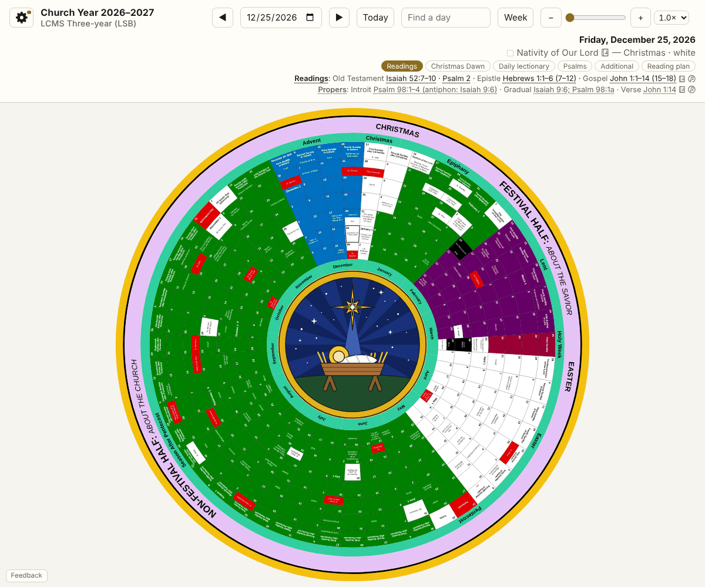

# Church Year Wheel

A church year drawn as a wheel: one wedge per week, one cell per day, colored
by the liturgical season, with the Sundays, festivals and commemorations
written in their cells and rings around them for the months, the seasons and
the parts of the year. It is a web page you can use in any browser, and a set
of Python scripts that draw the same wheel as an image and list a year's
colors, feasts and readings.



**Jump to:** [Using the calendar](#using-the-calendar) ·
[Running it yourself](#running-it-yourself) ·
[Changing or adding a church](#changing-or-adding-a-church) ·
[License](#license)

## The churches

It follows the LCMS calendar of *Lutheran Service Book* (2006) in either the
three-year or the one-year lectionary, and of its older hymnals, *Lutheran
Worship* (1982), *The Lutheran Hymnal* (1941) and the *Evangelical Lutheran
Hymn-Book* (1912). It also follows:

- The Roman Catholic General Roman Calendar, with any of 120 national,
  religious-order and personal-jurisdiction calendars laid over it, the
  Roman calendar of 1962 and the Ambrosian Rite of Milan;
- The ELS (one-year and three-year), Lutheran Church–Canada and WELS;
- The Episcopal Church, the ELCA, the United Methodist Church, the
  Presbyterian Church (U.S.A.), the Reformed churches, the Methodist Church in
  Britain, the Church of Scotland and the Moravian Church in America;
- Fourteen other Anglican prayer books, from 1662 to Common Worship, including
  the Church in Wales and books in Portuguese, and two calendars from books in
  the same tradition: the Catholic Personal Ordinariates' *Divine Worship* and a
  Western Rite Orthodox prayer book;
- The Lutheran churches of Sweden, Norway, Denmark, Finland, Iceland, Estonia,
  Latvia, Germany, Austria, Poland, Slovakia, Hungary and Spain, the HKBP and GKLI of
  Indonesia, Tanzania, Madagascar, and Australia and New Zealand, in their
  own languages;
- The Eastern Orthodox year, on the Revised Julian or Julian calendar, the
  Ukrainian Greek Catholic and Byzantine (Ruthenian) Catholic churches, and
  the Ukrainian Lutheran Church, Lutheran and Byzantine at once;
- The Armenian, Coptic, Ethiopian and Eritrean, Syriac and Malankara
  Orthodox churches, the Coptic and Ethiopian on their own calendars, the
  Maronite Catholic Church and the Assyrian Church of the East.

## Using the calendar

**[Open the calendar](https://churchyearwheel.github.io/ChurchYearWheel/)** — it runs in
your browser, on a computer, tablet or phone, and needs no account or
installation.

**[The user guide](docs/user-guide.md)** explains every control, key and
setting. In short:

- It opens on today, magnified on the current week at the top; `0` shows the
  whole wheel. Pick a date,
  step with the arrow keys, or click a day; **Find a day** (`F`) goes to a
  Sunday or feast by its name, and **Week** (`W`) lists a week's days and
  readings.
- The day's names, season, color and readings are shown above the wheel;
  each Bible citation opens the passage in the version you choose.
- The **gear** opens the settings: choose your church (and its lectionary or
  prayer book), how many feasts to show, which rings to draw and the picture
  in the middle. **Simple** shows the common ones; **All** shows everything.
- Magnify with the slider, the mouse wheel or `+` / `-`, or by pinching on a
  phone; drag to move around.
- The address always links to what is on screen, so you can bookmark or share
  a day, a church and its settings.
- **Print** gives the whole wheel on one page; **Download** saves it as an
  image, or the year's colors, feasts and readings as a table or calendar
  feed.
- To keep a copy that works offline, save the page from your browser
  (Ctrl+S, or ⌘S on a Mac). It is a single file.
- **Help**, in the bottom left corner, opens the user guide.

The user guide's sections:
[What you see](docs/user-guide.md#what-you-see) ·
[The bar](docs/user-guide.md#the-bar) ·
[Keys](docs/user-guide.md#keys) ·
[Mouse and touch](docs/user-guide.md#mouse-and-touch) ·
[Settings](docs/user-guide.md#settings-the-gear) ·
[Sharing a day](docs/user-guide.md#sharing-a-day-links) ·
[Downloading](docs/user-guide.md#downloading-the-wheel-and-its-lists) ·
[Printing](docs/user-guide.md#printing) ·
[A page for one church](docs/user-guide.md#a-page-for-one-church) ·
[Correcting the data](docs/user-guide.md#correcting-or-adding-to-the-data)

## Running it yourself

### Requirements

The scripts import nothing outside the Python standard library and use no
syntax newer than Python 3.7, so on a fresh machine you can copy the folder
across and run them — the SVG, the web page, the tables and the calendar feed
all build with no `pip install` at all. They run the same on macOS, Linux and
Windows.

A PNG needs one rasterizer. `png_renderer,auto` in `config.csv` uses the best
one present, in this order: **Inkscape**, **rsvg-convert**, **resvg**,
**Chrome/Edge** (already on most machines; **Pillow** trims its screenshot to
an exact size), then **CairoSVG** (`pip install cairosvg`, weakest on this
drawing's text). With none of them the SVG is still written.
`--list-renderers` shows what your machine has. See
[docs/rendering.md](docs/rendering.md) for the details and for fonts.

The checks in `web/` need Node.js, and `web/verify_pages.py` needs Playwright
as well (see [Checking changes](#checking-changes)). Nothing else does.

### The scripts

| Script | Writes |
| --- | --- |
| `church_year.py` | The web page: one HTML file that draws any year in the browser |
| `church_year_image.py` | The wheel as an image, SVG and PNG |
| `new_year.py` | The CSVs for another church year, and optionally its drawings |
| `colors.py` | Each Sunday and principal day (or every day) and its liturgical color; or each year's movable dates (`--overview`) |
| `feasts.py` | One church's feast days for a year: festivals, saints' days and commemorations, where the year keeps them, optionally linked to read about each |
| `lectionary.py` | One church's Bible readings for a year, optionally linked to Bible Gateway or Bible.com |

The last three write CSV, HTML, an iCalendar feed, JSON or Markdown; see
[docs/listings.md](docs/listings.md). The modules they share are in `lib/`.
Everything about a particular year, color, font, radius or ring lives in the
CSV files under `data/`.

### Quick start

```
python church_year.py                            # -> church_year.html, any year
python church_year_image.py                      # ./data -> SVG and PNG of the year
python new_year.py 2026 --draw                   # build and draw Advent 2026-27
python colors.py -o colors.ics                   # a calendar feed of this year's colors
python feasts.py roman 2025 -o feasts.html       # the Roman feasts of 2025-26, to print
python lectionary.py elca 2025 -o readings.csv   # the ELCA's readings for 2025-26
```

`-o` is short for `--output`.

### Building the web page

`church_year.py` writes one self-contained HTML file, about 2 MB, that draws
any year you ask for — no server, no network, nothing to keep up to date.

```
python church_year.py                       # -> church_year.html
python church_year.py -o wheel.html
python church_year.py --churches lcms-*     # offer only these churches
python church_year.py --year 2030           # open on a different year
python church_year.py --fragment            # to paste into a page of your own
python church_year.py --art my_cross.png    # your own picture, added to the Artwork menu
python church_year.py --list                # the churches' keys
```

`--fragment` keeps its styles and keys to itself inside another page.
`--fixed calendar,easter,artwork,reds` leaves those settings out, `--bible`
limits the Bible versions (`--bible english`, `--bible ESV`) and `--footer`
trims the lines under the wheel. The page's own **Make a page** (under the
gear) sets every option and gives the command back. See
[docs/web-page.md](docs/web-page.md) for all of them.

### Publishing the page with GitHub Pages

The repository builds and publishes the page by itself
([.github/workflows/pages.yml](.github/workflows/pages.yml)): on every push to
`main` it rebuilds the tables, checks that the browser's drawing still matches
the Python one, builds `church_year.html` and publishes it as the site's home
page. The built page is not kept in the repository.

To turn it on, once: **Settings → Pages → Build and deployment → Source:
GitHub Actions**. The page is then at `https://churchyearwheel.github.io/ChurchYearWheel/`;
each run is listed under the **Actions** tab, where **Run workflow** also
publishes by hand.

### Drawing the wheel as an image

```
python church_year_image.py                 # reads ./data, writes the SVG and a PNG
python church_year_image.py --no-png        # SVG only
python church_year_image.py --png-width 4200
python church_year_image.py roman 2027      # another church and year -> roman_2027-28_calendar.svg
python church_year_image.py 2026            # config.csv's church, Advent 2026
python church_year_image.py elca --from 2025 --to 2030 -o wheels/   # one wheel a year
python church_year_image.py lcms-one-year 2026 --no-latin-names
python church_year_image.py --art my_cross.png --art-credit "Photo: J. Smith"
python church_year_image.py --art celtic_cross             # any picture in data/artwork.csv
python church_year_image.py --hide halves --hide seasons   # leave rings out
python church_year_image.py --mid-text dark-reds           # black text on the mid-tone reds
python church_year_image.py --color-changes PURPLE-7a1f7a,ring.halves-e6c3f7   # repaint, as the page's Colors does
python church_year_image.py --art-date 2026-12-25          # the season's picture in the middle: the manger
python church_year_image.py --data years/2027 -o wheel.svg
python church_year_image.py --data years/2027 -o images/   # into a folder
python church_year_image.py --feasts festivals             # a less crowded wheel
python church_year_image.py --report        # also lists every label that had to shrink
python church_year_image.py --list          # the churches' keys
python church_year_image.py --list-renderers
```

With no church and no year it draws `./data` as it stands, as `config.csv`
says. Name a church or a year (or `--from`/`--to`, `--calendar`,
`--paschalion`, `--subcalendar`, `--latin-names`) and the year is worked out
from the rules exactly as `new_year.py` would, in a scratch folder, and drawn:
`config.csv` is not touched, and the wheel is the one `new_year.py` and then
`church_year_image.py` would make. The church and year take the same keys and
years as the listing scripts. `--art`, `--art-date`, `--art-credit`,
`--art-scale`, `--credit`, `--mid-text`, `--hide`, `--color-changes`,
`--png-background` and `--feasts` change only this drawing.

`-o` (`--output`, or the older `--out`) takes either a file name or a folder.
Given a folder — `images`, `images/`, `.\images\` — it writes the name from
`output_filename` (for a church named, `KEY_YYYY-YY_calendar.svg`) inside it,
creating the folder if needed. Several years need a folder. The PNG goes beside
the SVG, with the SVG's name unless `png_filename` gives it one (only when
drawing `./data` as it stands).

The picture in the middle can be your own: `--art`, or `center_svg` in
`config.csv`, takes an `.svg`, `.png`, `.jpg`, `.gif` or `.webp` file, looked
for in the current folder and then the project folder. An SVG's drawing is
copied in; a photo is embedded in the SVG (so it stays one file) and cut to the
circle. It is credited only if you give a credit (`--art-credit`,
`center_svg_credit`), and `--art-scale 0.9` (`center_svg_scale`) leaves a
margin. See [docs/rendering.md](docs/rendering.md#the-picture-in-the-middle).

### Another year

```
python new_year.py 2026                  # writes ./data_2026, copying ./data
python new_year.py 2026 --dry-run        # just print the dates
python new_year.py 2026 --draw           # and draw it: SVG, PNG and HTML
python new_year.py 2026 --lectionary lcms-one-year --latin-names
python new_year.py 2026 --lectionary roman --subcalendar united_states
python new_year.py 2026 --out data --force   # regenerate ./data in place
```

The year given is the year Advent begins, so `2026` means Advent 2026 through
November 2027. Everything else — Easter, the count of Sundays, the season
boundaries — is worked out from it. The web page needs none of this: it draws
any year from the rules.

### Readings, tables and calendar feeds

```
python lectionary.py --list                          # the churches, and which have readings
python lectionary.py lcms-three-year 2026            # 2026-27 as CSV, on the screen
python lectionary.py episcopal 2025 -o readings.md   # the format follows the extension:
                                                     #   .csv .json .md .html .ics
python lectionary.py lcms-elhb-one-year 2027 --format ics -o elhb.ics --no-daily
python lectionary.py elca 2025 --from 2026-03-01 --to 2026-04-30
python lectionary.py episcopal 2025 --links -o readings.html
python colors.py                                     # the year as date, weekday, title, color
python colors.py -o .                                # -> church_year_2026-27_colors.csv
python colors.py episcopal 2025 --colors all         # with the colors allowed and lower halves
python colors.py -o colors.ics                       # import into Google/Apple/Outlook
python colors.py --from 2025 --to 2035 --overview    # Easter and the rest, year by year
python feasts.py lcms-three-year 2025 --feasts festivals -o feasts.md
```

The year is the one the church year begins in. The readings' CSV has one row
per reading (date, weekday, the day's names, the set it belongs to, its kind
and the citation); the calendar feed has one all-day event per day with the
readings in its description. They are the readings the web page lists, and
`python web/verify_readings.py` checks that the two agree.

## Changing or adding a church

Each tradition is a folder of rules under `data/`, so others can be added:
[docs/adding-a-church.md](docs/adding-a-church.md) is a step-by-step guide,
with an example folder to copy.

### The documentation

| | |
| --- | --- |
| [docs/user-guide.md](docs/user-guide.md) | How to use the web page: every control, key and gesture, links and printing, for anyone using the wheel |
| [docs/web-page.md](docs/web-page.md) | The web page in full: building it, its options, links, phones, printing, rings, magnification, and how its renderer is kept identical to the Python one |
| [docs/adding-a-church.md](docs/adding-a-church.md) | A step-by-step guide to adding another church's calendar, with an example folder to copy |
| [docs/traditions.md](docs/traditions.md) | The traditions, the date language their rules are written in, Roman precedence, the calendars laid over the Roman one, icons, artwork, and adding a tradition |
| [docs/liturgy.md](docs/liturgy.md) | The two lectionaries, Pre-Lent, Latin names, how feasts are chosen, the weeks after Easter, the halves of the year and where the festival half ends, how the dates are worked out |
| [docs/calendars.md](docs/calendars.md) | Gregorian, Julian and Revised Julian, the Western and Eastern Easter, and how far back and forward the wheel goes |
| [docs/listings.md](docs/listings.md) | `colors.py`, `feasts.py` and `lectionary.py`: their shared options, the five formats, links, the major days, the overview and the calendar feed |
| [docs/versification.md](docs/versification.md) | The two ways of numbering Bible verses, which churches cite which, and how the links translate |
| [docs/provenance.md](docs/provenance.md) | Where each calendar's days, feasts, colors, names, readings and art come from, and what is missing, guessed or uncited (written from `docs/provenance.csv` by `tools/provenance.py`); [docs/provenance-review.md](docs/provenance-review.md) lists data that disagree with a source |
| [docs/data-files.md](docs/data-files.md) | Every CSV in `data/` and every setting in `config.csv` |
| [docs/rendering.md](docs/rendering.md) | The image: PNG export, fonts, small caps, and tuning notes for tight labels |
| [CHANGELOG.md](CHANGELOG.md) | What has changed |
| [LICENSE](LICENSE), [LICENSE-CC0.txt](LICENSE-CC0.txt) | The licenses: MIT No Attribution for the code, CC0 1.0 for the data, artwork and documentation ([License](#license)) |

### Where things are

```
church_year.py          The web page
church_year_image.py    The wheel as an image, and the drawing the page's is a port of
new_year.py             A year's dated CSVs
colors.py               A year's colors, as tables and calendar feeds
feasts.py               A church's feast days for a year
lectionary.py           A church's Bible readings for a year
lib/                    What the scripts share, not run on its own:
  calendars.py            Gregorian, Julian and Revised Julian arithmetic
  traditions.py           The traditions' rules, worked out into a year
  listing.py, links.py    The three listing scripts' options and formats; the page's links
  versification.py        Hebrew to English verse numbers
artwork/                The pictures for the middle, and their credits
data/                   The CSVs and config.csv for the current year
data/LCMS/, data/Roman/, Each tradition's rules, feasts and calendars; a church's
  data/Episcopal/, ...    other books sit inside its folder (data/LCMS/LSB, data/LCMS/LW,
                          data/LCMS/TLH, data/LCMS/ELHB, data/LCMS/Loehe, data/Roman/1962)
data/readings/          Shared lectionaries (LSB, RCL, Common Worship ...) and reading
                          plans (plan-rwg.csv) that churches name
web/                    The browser renderer, its styling, and the checks
docs/                   The detailed documentation
docs/source-errors.csv  Mistakes found in the sources, and what the calendar uses instead
tools/                  Maintenance scripts; see tools/README.md
.github/workflows/      The build that publishes the page with GitHub Pages
```

### Checking changes

The browser draws with a JavaScript port of `church_year_image.py`, and the
two are kept identical byte for byte. After changing either renderer, run:

```
python web/verify.py                      # 20 years, both LCMS series
python web/verify.py --lectionary all     # every tradition
python web/verify.py --lectionary roman --subcalendar each   # every Roman calendar
python web/verify.py --calendar all       # every calendar and Easter pairing
python web/verify_bc.py                   # the years before AD 1
python web/verify_readings.py             # the page's readings against lectionary.py
python web/verify_readings.py --church elca --from 2025 --to 2040   # one church
python web/verify_links.py                # the page's Bible and feast links against lib/links.py
python web/verify_lists.py                # the page's downloaded lists against the three scripts
python web/verify_pages.py                # Make a page against church_year.py (needs Playwright)
```

The first of them also runs before every publish to GitHub Pages.

## License

Everything made for this project is free to use, change and pass on however
you like, for any purpose; no credit is needed.

- **The code** (the Python scripts, the page's JavaScript and CSS, and the
  tools) is under [MIT No Attribution](LICENSE) (MIT-0): the MIT license
  without its condition that the notice be kept.
- **The data, the artwork and the documentation** are given to the public
  domain under [CC0 1.0](LICENSE-CC0.txt).

That covers only what is the project's own. The lectionaries and calendars
belong to their publishers and churches: the project records which days each
keeps and which readings it appoints, as a reference to them, and
[docs/provenance.md](docs/provenance.md) names the source of each. Among
them, the *Revised Common Lectionary* is copyright © 1992 Consultation on
Common Texts and its *Daily Readings* copyright © 2005 Consultation on Common
Texts, and *Lutheran Service Book* is copyright © 2006 Concordia Publishing
House. Three of the crosses were already in the public domain
([artwork/CREDITS.md](artwork/CREDITS.md)). The churches' names are their
own, and none of them has reviewed or endorsed this project.
